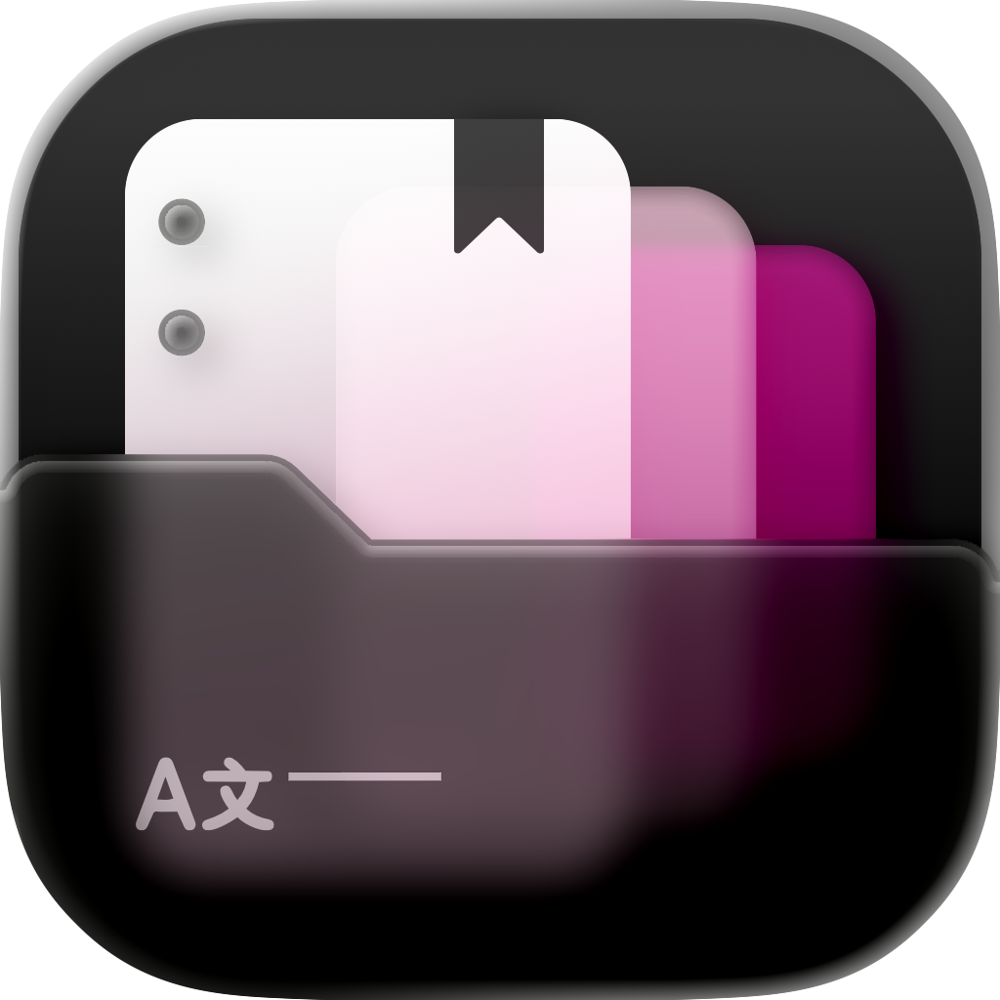
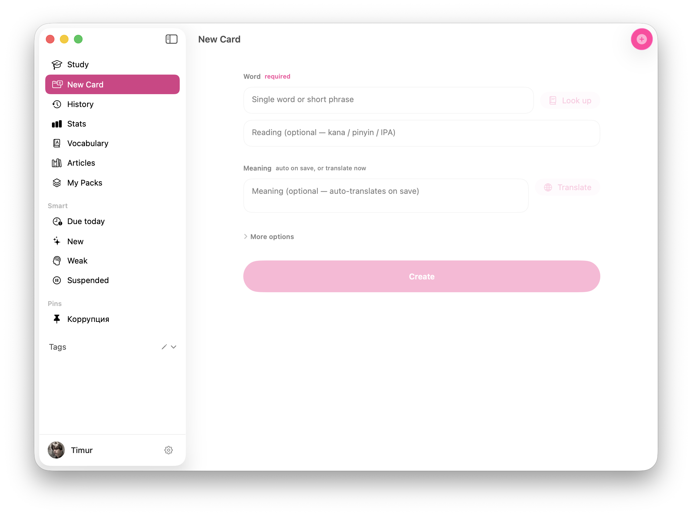

<div align="center">



# Melingo.

**Read the language. Keep what stays.**\
Local-first language learning for macOS — reading, cards, and FSRS review in one quiet workspace.

[](https://github.com/timurverevkin/Melingo)
[](https://swift.org)
[](LICENSE)
[](https://github.com/timurverevkin/Melingo/releases/download/Release/Melingo-0.3.1.dmg)

**As featured on**

[](https://github.com/jaywcjlove/awesome-swift-macos-apps)
</div>

<p align="center">
  
</p>

Melingo is a native macOS app for people who learn by living inside text — articles, books, screenshots, stray sentences — and want those encounters to become memory without turning study into a second job.

It is local-first. Your library, cards, and voice live on your Mac. The AI that helps you is on-device when it can be. Nothing here asks you to perform productivity.

---

### What’s new in 0.3.1

- **Dictation** study mode — type the other side of the card; each item randomly asks for the study language or your native language, with a clear language chip.
- **YouTube** in the library — open a video with timed subtitles, tap words, and save cards from captions.
- **Telegram** channels — authorize once, export `@channel` posts + media, browse in a Telegram-styled reader (session sync via Firebase for another Mac).
- Reader / library polish — sturdier word tapping, translation flows, and import paths for the new source kinds.

---

### The idea

Most language apps start with a queue. Melingo starts with a page.

You open something worth reading. You touch a word when it matters. A card appears when the moment is useful — not because a streak demanded it. Review exists, and it is serious (FSRS), but it speaks softly. Tomorrow will still know your place.

---

### What you get

**A library that behaves like reading**  
Import from the web, paste, PDF, EPUB, Markdown, plain text, Word, OCR. Read original, bilingual, or translation. Click a word — look up, hear it, add a card. Explain a sentence when you want depth, not when a tutorial says so.

**Vocabulary that remembers how memory works**  
FSRS-powered review with recognition and production, hints, speak-after-reveal, and grades that don’t shout. Soft daily reminders in your language — fifteen calm lines, never “time to grind.”

**Study that feels like practice, not homework**  
Context, collocations, dictation, challenge, mini-dialogue, voice mix, OCR — modes that unlock as your deck grows, with honest rules instead of dark patterns.

**Intelligence that stays home**  
Apple Intelligence / Foundation Models for light work. Local Gemma (MLX) when the Mac can carry it. Routing that prefers privacy and latency over a cloud login wall.

**macOS as the surface**  
Menu bar agent, Services (“add a card to Melingo”), reading mode under the notch, keyboard-first flows, design tokens that follow system light and dark. An Icon Composer app icon that adapts with the OS — glass when the system wants glass.

**Packs & pins**  
Organize by tags and packs. Pin what you’re living in. Generate or import packs when you need a structured push — without losing the reading-first spine.

---

### Who it’s for

Learners who already have too many apps and still lose words they met in the wild.  
People who want Anki-grade scheduling without Anki-grade ceremony.  
Anyone who believes a pause is also part of the path.

---

### Install

Download the latest `.dmg` from [Releases](https://github.com/timurverevkin/Melingo/releases) (macOS 15+ recommended).

1. Open the DMG and drag **Melingo** into Applications  
2. First launch: right-click → **Open** (once, if Gatekeeper asks)  
3. Optional: select text anywhere → Services → add a card  

Data lives under your Documents Melingo folder — yours, offline, portable in spirit if not yet in a one-click sync product.

---

### Build from source

Requirements: macOS 15+, Xcode 16+

```bash
cd MelingoMac-revu   # or open MelingoMac.xcodeproj
xcodebuild \
  -project MelingoMac.xcodeproj \
  -scheme MelingoMac \
  -destination 'platform=macOS' \
  -configuration Release \
  build
```

Packaging helpers live in `Scripts/` (`BuildApp.command`, `CreateDMG.command`, `Release.command`). No API keys required to run the core app; AI features use what’s installed on the machine.

---

### Shape of the code

Opinionated layers, not a framework museum:

| Area | Role |
|------|------|
| `App/` | SwiftUI workspace, reader, study, vocabulary, settings |
| `Packages/Domain` | Models and language-pair truth |
| `Packages/DataKit` | Local persistence |
| `Packages/AIKit` / `MLXAdapter` | On-device models and routing |
| `Packages/ContentImportKit` | Bringing text into the library |
| `Packages/TelegramKit` | TDLib channel export + Firebase session sync (`telegram-export` CLI) |

UI strings follow the learner’s native language (`AppL10n`). Reminders are scheduled as calm local notifications — content from localization, not hard-coded urgency.

---

### Principles (non-negotiable)

1. **Reading is the front door.** Study is the hallway.  
2. **Local beats clever.** Cloud is optional ambition, not the default tax.  
3. **Tone matters.** Copy that shames the learner doesn’t ship.  
4. **One job per surface.** The first viewport is not a dashboard of guilt.  

---

### License & name

Apache License 2.0 — see `LICENSE`. **Melingo** is the product name; treat the mark with the same care you’d want for your own.

---

*Breathe. Open. Look at one word.*

---

### Inspiration

Functionality inspired by [openkoto](https://github.com/hikariming/openkoto) and [revu-swift](https://github.com/JuliusBrussee/revu-swift/tree/main).
